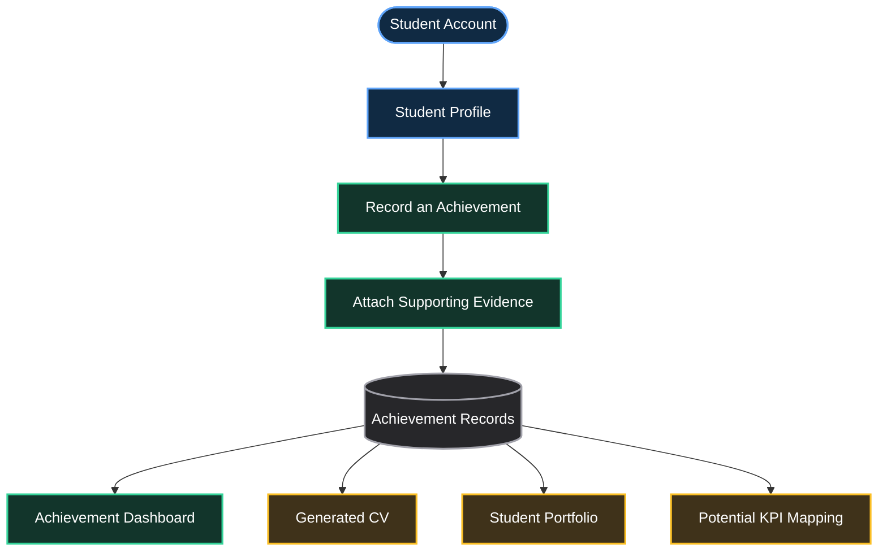
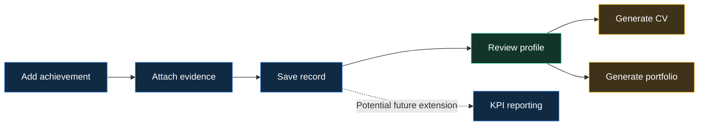
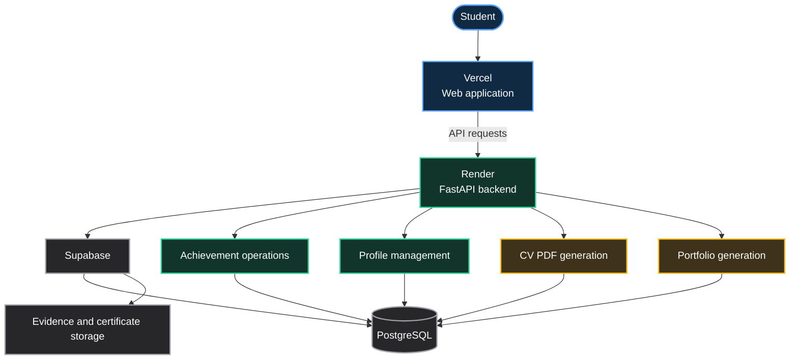

<div align="center">

# LIWATRACK

### STUDENT ACHIEVEMENTS. STRUCTURED. DOCUMENTED. READY TO SHOWCASE.

**From scattered certificates to a structured student portfolio.**

A digital achievement tracking system exploring how student accomplishments can be recorded, supported by evidence, and transformed into professional CVs and portfolios.

<br/>

[**↗ LIVE APPLICATION**](https://liwa-achievement-tracker.vercel.app/)

[**⌘ SOURCE CODE**](https://github.com/Sumaya04122006/Liwa-Achievement-Tracker)

<br/>

`ACHIEVEMENT TRACKING` · `EVIDENCE MANAGEMENT` · `CV GENERATION` · `PORTFOLIO GENERATION`

</div>

---

## ✦ The problem

A student's university journey can produce dozens of achievements:

- Academic awards and recognitions
- Research papers and presentations
- Internships and professional experience
- Technical projects
- Certificates and microcredentials
- Competitions and extracurricular activities
- Academic events and professional development

Yet these records often end up scattered across folders, emails, cloud drives, and different platforms.

When an internship application, scholarship, CV update, or research opportunity arrives, students may need to reconstruct their accomplishments from scratch.

**The problem is not a lack of achievements. It is the lack of one organized, evidence-supported record of those achievements.**

LiwaTrack explores a more structured approach.

---

## 🧭 What is LiwaTrack?

LiwaTrack is a student achievement tracking application developed around a simple idea:

> Record an achievement once. Keep its supporting evidence organized. Reuse the information across your professional profile and generated documents.

Students can maintain a structured record of their accomplishments, attach relevant supporting files, manage their profile, and generate a CV and portfolio from the information stored in the application.

The project also explores a broader research direction: whether structured student achievement records could support more systematic, evidence-based monitoring of university performance indicators.

**Two related but distinct goals:**

- **The application:** helps students organize and present their achievements.
- **The research framework:** explores how structured records could support KPI monitoring and reporting.

The application is a working project; institution-wide adoption and the effectiveness of the broader framework would require separate evaluation.

---

## ✨ Explore the application

<div align="center">

### One structured record. Multiple uses.

</div>



---

## 🚀 Core features

### 01 — Achievement management

Maintain an organized record of accomplishments instead of rebuilding a CV from disconnected documents.

The application supports achievement creation, viewing, editing, and deletion.

Achievement records can cover areas such as research, awards, projects, internships, certifications, and academic activities.

### 02 — Evidence and certificate storage

Achievements become more useful when supporting documentation is available.

LiwaTrack includes evidence and certificate storage and retrieval, allowing supporting files to be associated with achievement records.

This establishes an important distinction: a recorded achievement can have supporting evidence, but storing a document does not independently verify that document's authenticity.

### 03 — Student profile

Maintain profile information, including professional links such as LinkedIn and GitHub.

A structured profile gives the application information to reuse when presenting achievements through generated documents and portfolio pages.

### 04 — Automated CV generation

Generate a PDF CV from the achievement information recorded in the application.

The aim is to reduce the repeated manual work involved in updating a CV whenever a student completes a new project, earns a certificate, or records another accomplishment.

### 05 — Portfolio generation

Turn structured achievement records into a portfolio that can present a student's academic and professional development in one place.

This creates a second use for the same underlying records rather than requiring students to maintain a completely separate portfolio manually.

### 06 — Updates from the source records

The generated CV can be updated when achievement records change, reducing the need to recreate the document from scratch.

The key design principle is that achievement records act as the source information for the generated outputs.

---

## 🔄 The central workflow



The workflow demonstrates the project's core value: **the same structured achievement data can serve multiple purposes.**

KPI reporting is shown as a potential extension of the research framework; it should not be interpreted as proof that the deployed application automatically calculates or validates institutional KPIs.

---

## 🏗️ Technical architecture

LiwaTrack uses a web application architecture with a frontend, a Python API backend, and a managed database and evidence-storage layer.



*Conceptual architecture: confirm the actual request paths, storage configuration, and security policies against the current source code before treating every connection as an implementation-level guarantee.*

### Technology stack

| Layer | Technology | Role |
|---|---|---|
| Backend | Python | Application logic |
| API framework | FastAPI | Backend endpoints |
| Database platform | Supabase | Managed data services |
| Relational database | PostgreSQL | Structured achievement records |
| Evidence storage | Supabase storage services | Supporting files and certificates |
| Frontend deployment | Vercel | Web application hosting |
| Backend deployment | Render | API hosting |
| Version control | Git and GitHub | Source code and project history |

---

## 🗂️ Data model: the underlying idea

A structured achievement record can be represented conceptually as:

```json
{
  "achievement_title": "Research Presentation",
  "category": "Research",
  "description": "Presented a student research project.",
  "date": "2026-10-01",
  "evidence": [
    {
      "type": "certificate",
      "description": "Supporting presentation certificate"
    }
  ],
  "links": {
    "project": null,
    "publication": null
  }
}
```

This is an illustrative data structure, not a claim about the exact database schema used by the deployed application.

A structured record makes it easier to organize achievements, retrieve associated evidence, and reuse relevant information when generating documents.

A future schema could also include verification status, issuer information, evidence metadata, and KPI mappings.

---

## 🔬 Research direction: evidence-based KPI monitoring

LiwaTrack began as more than a CV generator. It also provides a starting point for exploring how structured student achievement records might contribute to evidence-based university reporting.

University performance indicators can involve research, placements, microcredentials, and academic engagement. Records that are consistently structured and linked to evidence could make relevant information easier to retrieve and review.

Potentially relevant OBEF KPI areas include:

| KPI reference | Potential connection |
|---|---|
| 2.5 — Microcredentials / licenses | Records of certificates and credentials |
| 3.2 — Placements | Records of internships and placements |
| 4.4 — Research | Records of research activities and outputs |
| 6.1 — Academic events | Records of participation in relevant events |

These are potential mappings for research and reporting, not evidence that LiwaTrack has been officially adopted, certified, or validated against the institution's KPI reporting requirements.

### Research question

**How can structured, evidence-supported student achievement records improve the organization, retrieval, and potential reporting of student accomplishments?**

Possible future evaluation could examine:

- Time required to prepare a CV before and after using the system.
- Completeness of achievement records.
- Ease of retrieving supporting evidence.
- Accuracy of mapping records to predefined KPI categories.
- Usability and perceived usefulness for students.
- Reliability of generated CV and portfolio information.

Measured results should be published only after conducting and documenting an actual evaluation.

---

## 🧪 How to evaluate the project properly

A strong next step is to evaluate LiwaTrack as a software product rather than relying only on its feature list.

| Evaluation area | What to test |
|---|---|
| Achievement CRUD | Create, edit, retrieve, and delete records |
| Evidence management | Upload, retrieve, and handle missing files |
| Authentication | Access restrictions between student accounts |
| CV generation | Correctness and completeness of generated content |
| Update behavior | Whether changes appear in regenerated outputs |
| Portfolio generation | Accurate rendering of recorded achievements |
| Data integrity | Behavior when records are incomplete or invalid |
| Usability | Whether students can complete common tasks easily |

The results can then support specific claims about reliability and usefulness. Until those tests have been performed, avoid assigning performance percentages or claiming that the system has demonstrated measurable institutional impact.

---

## 🔐 Security and data integrity

Achievement records and certificates may contain personal information. Any wider deployment should consider:

- Authentication and authorization for every protected operation.
- Student-level access isolation.
- Appropriate access controls for uploaded evidence.
- Secure handling of credentials and API keys.
- Input validation and safe file-upload restrictions.
- Data retention and deletion policies.
- Backups and recovery procedures.
- Privacy-conscious handling of generated CVs and portfolios.

Using a managed database does not automatically guarantee that records are private or that access controls are configured correctly. Those controls need to be reviewed and tested.

---

## ⚠️ Current scope and limitations

A no-sugar-coating view of LiwaTrack:

- **It is a student achievement management application**, not yet evidence of a university-wide student information system.
- **Evidence storage is not evidence verification.** Authenticity requires a separate verification process.
- **CV generation does not guarantee a perfect CV.** Output formatting and content accuracy need testing.
- **KPI mapping is not institutional validation.** Official reporting requires agreed definitions, validation rules, and appropriate review.
- **A deployed application does not prove adoption.** User numbers, usage, and institutional impact must be supported by actual evidence.
- **Automated updates depend on the implementation.** Generated documents should be checked to ensure they reflect the latest records as intended.

These boundaries do not weaken the project. They make its real engineering contribution easier to understand and defend.

---

## 🔭 Future roadmap

<details>
<summary><strong>Phase 1 — Strengthen the current product</strong></summary>

- [ ] Test the complete achievement-to-CV workflow.
- [ ] Improve CV layout and formatting options.
- [ ] Improve evidence metadata and organization.
- [ ] Add clearer validation and error handling.
- [ ] Review authorization and file-access controls.
- [ ] Document the deployed architecture and database schema.

</details>

<details>
<summary><strong>Phase 2 — Smarter achievement management</strong></summary>

- [ ] Explore extracting achievement details from uploaded certificates.
- [ ] Add user review before extracted information is saved.
- [ ] Explore duplicate detection for achievement records.
- [ ] Add richer portfolio customization.
- [ ] Explore additional export formats.

</details>

<details>
<summary><strong>Phase 3 — LiwaTrack as a broader framework</strong></summary>

- [ ] Explore AI-assisted extraction from student-submitted evidence.
- [ ] Explore integrations with approved university systems.
- [ ] Design configurable KPI mapping and reporting.
- [ ] Add review workflows for authorized staff.
- [ ] Evaluate data completeness and reporting accuracy.
- [ ] Investigate a shared achievements platform, subject to institutional requirements and approval.

</details>

AI-based certificate extraction, shared institutional access, and automated KPI reporting are future directions unless separately implemented and tested.

---

## 👩‍💻 About the developer

**Sumaya Fathima**  
Bachelor of Information Technology — Artificial Intelligence  
Liwa University · Abu Dhabi, UAE

[GitHub](https://github.com/Sumaya04122006) · [LinkedIn](https://www.linkedin.com/in/sumaya-fathima-7148063a9)

LiwaTrack was developed as an independent project to explore practical student-facing software, structured achievement data, and the potential connection between digital records and evidence-based reporting.

---

<div align="center">

## LIWATRACK

### Your achievements deserve a system, not scattered files.

**Capture the work. Preserve the evidence. Showcase the journey.**

[**↗ EXPLORE THE LIVE APPLICATION**](https://liwa-achievement-tracker.vercel.app/)

[**VIEW SOURCE CODE**](https://github.com/Sumaya04122006/Liwa-Achievement-Tracker)

</div>
